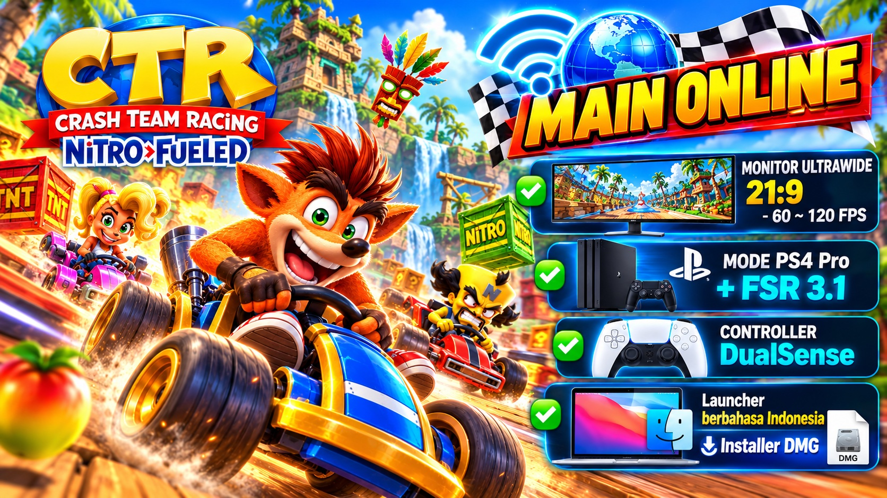

<p align="center"></p>

# CTR-Online on Mac — port macOS tidak resmi dari OCTR



**Bahasa:** [English](README.md) · Bahasa Indonesia


**Port macOS (Apple Silicon) dari [OCTR: CTR Nitro-Fueled PC, online](https://github.com/Ryu7w7/OCTR-NitroFueled-PC), dikerjakan oleh Momochan32.**

> **Tentang proyek ini.** Ini **fork** dari OCTR, bukan proyek yang dibuat dari nol. Hampir seluruh isinya hasil karya proyek-proyek komunitas yang disebut di bawah: cara menjalankan game di PC, grafis, mode online, patch, dan launcher. Fork ini menambahkan **dukungan macOS** (rinciannya di [Yang ditambahkan fork ini](#yang-ditambahkan-fork-ini)).
>
> Port ini **tidak resmi** dan independen: tidak berafiliasi dengan, dan tidak didukung oleh, tim OCTR, SacredFire, CTR-NitroFueled-PC, shadPS4, Activision, Beenox, maupun Sony. Supaya tidak menambah beban para pengembang asli, laporkan hal yang khusus versi Mac di [Issues repo ini](https://github.com/momochan32/ctr-on-mac/issues).


---

## Asal-usul proyek

Proyek ini berdiri di atas rangkaian karya komunitas berikut:

1. **[SacredFire](https://github.com/T3CHNOLOG1C/SacredFire)** (T3CHNOLOG1C): port PC native untuk Linux, berbasis desain runtime **bbport**.
2. **[CTR-NitroFueled-PC](https://github.com/GetLostIn/CTR-NitroFueled-PC)** (GetLostIn): build Windows dari SacredFire, termasuk banyak perbaikan rendering.
3. **[OCTR](https://github.com/Ryu7w7/OCTR-NitroFueled-PC)** (Ryu7w7 dan kontributornya): fork online (server RyuNET, lobby, matchmaking, teman), launcher, dan mods. **Repo inilah yang di-fork.** Riwayat commit-nya dipertahankan di repo ini.
4. **CTR-Online on Mac** (repo ini): port macOS dari OCTR.

Komponen pihak ketiga yang dipakai:
- **[shadPS4](https://github.com/shadps4-emu/shadPS4)**: inti grafis PS4 dan shader recompiler (di-vendor oleh proyek asal).
- **Mesa KosmicKrisp**: driver Vulkan di atas Metal yang membuat versi Mac ini mungkin.
- **AMD FidelityFX (FSR 3.1)**, **SDL3**, **GTK4 / libadwaita**, **LibAtrac9**, dan library lain sesuai lisensinya masing-masing.

Nama "CTR-Online on Mac" hanya nama deskriptif untuk port macOS ini. Bukan rilis resmi OCTR.

---

## Yang ditambahkan fork ini

Semua perubahan bisa dilihat di riwayat commit. Garis besarnya:

**Port ke macOS**
- Runtime di macOS / Rosetta 2: pengganti API khusus Linux (`src/compat_mac.h`), TCB guest di slot `pthread` (meniru pendekatan port Windows di proyek asal), rentang memori PS4 digeser di atas area yang dipakai GPU Apple Silicon, dan page fault lewat `SIGBUS`.
- Grafis: build library GPU untuk macOS, jendela SDL di main thread, surface Metal lewat KosmicKrisp, dan memori game diimpor ke Vulkan (`VK_EXT_external_memory_host`).
- Pengaturan yang disesuaikan untuk sistem grafis Mac: diagnostik GPU breadcrumbs dimatikan secara default di macOS (di sana biayanya besar untuk performa), MSAA belum ditawarkan (belum tampil dengan benar di setup ini), dan FSR 3.1 mendapat fallback tipe memori untuk unified memory Apple.
- Restart dari dalam game lewat `posix_spawn`.

**Launcher dan paket**
- Default untuk Mac, Play/Stop di sesi proses sendiri, dan opsi yang tidak didukung Mac disembunyikan.
- Terjemahan Bahasa Indonesia dan halaman kredit.
- Aplikasi `.app` dan DMG.

Fitur game (online, patch, layout 21:9, FSR, mods, pencapaian) **adalah karya proyek-proyek asal**. Fork ini membuatnya bisa dipakai di Mac.

---

## Tampilan di Mac

| Ultrawide 21:9 (2560×1080) | MacBook Pro (fullscreen 2560×1440) |
|---|---|
|  |  |
|  |  |

| Online: memuat balapan (FPS + ping) | Online: balapan dengan pemain lain |
|---|---|
|  |  |

| Lobby online | Pilih kart |
|---|---|
|  |  |

| Launcher (Bahasa Indonesia) | Pencapaian |
|---|---|
|  |  |

### Hasil uji (satu perangkat: MacBook Pro M3 Max)

Angka ini dari pengujian pribadi di satu Mac, bukan benchmark resmi. Hasil di Mac lain bisa berbeda.

| Skenario | FPS saat balapan |
|---|---|
| Monitor ultrawide 2560×1080 (75 Hz), layout 21:9 | ~75 (batas monitor) |
| Balapan online di ultrawide | ~61 |
| Layar MacBook, mode PS4 Pro + FSR 3.1 AA | ~63–70 |

---

## Instalasi

### Yang dibutuhkan
- Mac Apple Silicon, macOS 14 ke atas (baru dites di M3 Max)
- **Rosetta 2**: `softwareupdate --install-rosetta --agree-to-license`
- **Homebrew** ([brew.sh](https://brew.sh)):
  ```sh
  brew install bash python gtk4 libadwaita pygobject3 adwaita-icon-theme
  ```
- **Game milikmu sendiri.** Dump CTR Nitro-Fueled **CUSA13795 v1.21** (base + update digabung) dari konsol/salinan yang kamu miliki secara sah. **Repo dan rilis ini tidak menyertakan, membagikan, atau menautkan file game, firmware, maupun kunci apa pun.** Permintaan file game tidak dapat dilayani.

### Pasang
1. Unduh `CTR-Online-on-Mac.dmg` dari [Releases](https://github.com/momochan32/ctr-on-mac/releases).
2. Buka DMG, lalu seret **CTR-Online on Mac** ke **Applications**.
3. Aplikasi ini tidak ditandatangani Apple. Saat pertama kali dibuka: klik kanan → **Open** → **Open**.

### Pertama kali jalan
1. **Pengaturan → Game**: pilih folder game yang berisi `eboot.bin`.
2. Tekan **Main**. Saat pertama kali, launcher meminta kamu **memilih nickname sendiri** (3–16 huruf, angka, `_` atau `-`). Tidak ada nickname yang diisikan otomatis: game baru bisa dimulai setelah nickname yang valid diisi. Nickname ini adalah namamu di dalam game dan saat online, dan instalasi pertama yang memakainya secara online akan memilikinya. Bisa diganti nanti di **Pengaturan → Online (RyuNET)**.
3. (Opsional) **Online (RyuNET)**: nyalakan di Pengaturan untuk balapan dengan pemain lain.
4. Start pertama menyiapkan shader (sekitar 2 menit).

Pengaturan dan save disimpan di `~/Library/Application Support/CTR-Online`. Menu di dalam game dibuka dengan **Shift + W** (atau F1 / Insert / L3+R3).

---

## Tentang mode online

Mode online memakai **server RyuNET milik proyek OCTR**, bukan server milik fork ini.
- Aturan, moderasi, dan ban sepenuhnya wewenang admin OCTR. Patuhi aturan mereka (tercantum di launcher).
- Pertanyaan atau banding soal server diajukan di komunitas OCTR (tautan Discord ada di launcher).
- Versi Mac bisa saja berperilaku berbeda dari versi resmi. Setiap permintaan admin server terkait klien tidak resmi akan diikuti.

---

## Batasan yang diketahui

- MSAA belum tersedia di Mac; anti-aliasing FSR 3.1 dipakai sebagai gantinya.
- Mode PS4 Pro otomatis mati saat layout 21:9 aktif (perilaku proyek asal).
- Layar MacBook (16:10) menampilkan bar hitam tipis, karena game ini 16:9.
- Baru dites di satu perangkat (MacBook Pro M3 Max).

---

## Build dari source

```sh
git clone --recursive https://github.com/momochan32/ctr-on-mac && cd ctr-on-mac
# library pendukung diambil dari checkout shadPS4 (SHADPS4_EXTERNALS), plus Vulkan loader + KosmicKrisp
cmake -S gpu -B out/gpu-mac -G Ninja -DCMAKE_OSX_ARCHITECTURES=x86_64 -DBB_LTO=OFF
ninja -C out/gpu-mac sacredfire bb-gpu-capabilities
./packaging/macos/make_dmg.sh        # -> out/CTR-Online on Mac.dmg
```

---

## Kredit & terima kasih

Terima kasih kepada semua orang yang karyanya menjadi dasar port ini:

- **T3CHNOLOG1C**: SacredFire, port Linux native.
- **GetLostIn**: CTR-NitroFueled-PC (build Windows, perbaikan MSAA, bulu karakter, rendering).
- **Ryu7w7** dan kontributor OCTR: mode online RyuNET, server, launcher, mods, dan banyak perbaikan.
- **Kontributor OCTR** yang disebut di riwayat rilisnya, antara lain tcosi (layout 21:9/32:9, mods), Brony666 (launcher Linux, Achievements, Mods), SoyAlejandroCalixto, Vo1dTear, n0buholic, MetaHeart, dan Naif Alqurashi. Daftar lengkapnya ada di [README-OCTR.md](README-OCTR.md) dan riwayat commit repo ini.
- **bbport**: desain runtime asal.
- **Tim shadPS4**: inti grafis dan shader recompiler.
- **Pengembang Mesa / KosmicKrisp**: Vulkan di atas Metal.
- **illusion** (PS-Game-Patch): patch 60 FPS dan motion blur. **TroyWarez**: patch Pro 1080p. **Camiloop**: Unlock Everything.
- **AMD**: FidelityFX FSR 3.1.
- **Komunitas Crash Team Racing**.

Pengerjaan port macOS dibantu oleh Claude (Anthropic) sebagai asisten pemrograman. Karena itu sebagian commit mencantumkan `Co-Authored-By: Claude`.

Kalau ada nama atau karya yang terlewat atau salah disebut, kabari lewat Issues dan akan segera diperbaiki.

---

## Lisensi & catatan legal

- Kode berlisensi **GPL-2.0-or-later**, sama seperti proyek asal (lihat [LICENSE](LICENSE)). Komponen pihak ketiga mengikuti lisensinya masing-masing. Source lengkap untuk setiap rilis ada di repo ini.
- *Crash Team Racing Nitro-Fueled*, *Crash Bandicoot*, dan semua merek terkait adalah milik **Activision Publishing, Inc.** *PlayStation* dan *PS4* adalah merek **Sony Interactive Entertainment**. Nama-nama tersebut dipakai hanya untuk menjelaskan kompatibilitas.
- Proyek komunitas non-komersial untuk pemakaian pribadi dan preservasi: tidak dijual, tidak menerima donasi, dan tidak berisi konten milik pemegang hak game.
- Pemegang hak yang keberatan dengan isi repo ini dapat menghubungi lewat Issues, dan akan segera ditindaklanjuti.

> README asli proyek OCTR: [README-OCTR.md](README-OCTR.md)
