<p align="center"></p>

# CTR-Online on Mac — an unofficial macOS port of OCTR

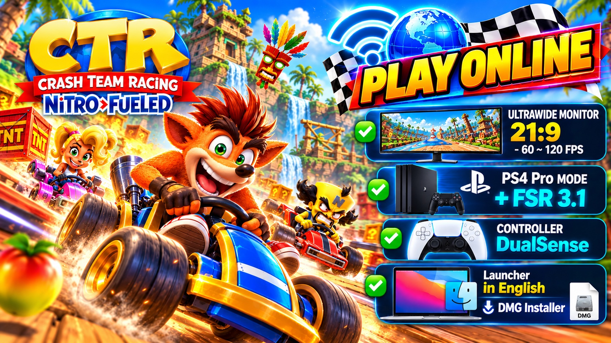

**Language:** English · [Bahasa Indonesia](README.id.md)

**A macOS (Apple Silicon) port of [OCTR: CTR Nitro-Fueled PC, online](https://github.com/Ryu7w7/OCTR-NitroFueled-PC), by Momochan32.**

> **About this project.** This is a **fork** of OCTR, not a project built from scratch. Nearly everything in it is the work of the community projects listed below: running the game natively on PC, graphics, online play, patches and the launcher. This fork adds **macOS support** (details in [What this fork adds](#what-this-fork-adds)).
>
> This port is **unofficial** and independent: it is not affiliated with or endorsed by the OCTR, SacredFire, CTR-NitroFueled-PC or shadPS4 teams, nor by Activision, Beenox or Sony. To keep the upstream maintainers' time free, please report anything specific to the Mac version in [this repository's Issues](https://github.com/momochan32/ctr-on-mac/issues).

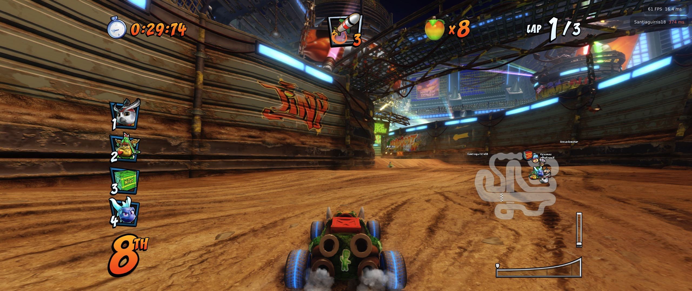

---

## Where this comes from

This project builds on the following community work:

1. **[SacredFire](https://github.com/T3CHNOLOG1C/SacredFire)** (T3CHNOLOG1C): the native Linux PC port, based on the **bbport** runtime design.
2. **[CTR-NitroFueled-PC](https://github.com/GetLostIn/CTR-NitroFueled-PC)** (GetLostIn): the Windows build of SacredFire, with many rendering fixes.
3. **[OCTR](https://github.com/Ryu7w7/OCTR-NitroFueled-PC)** (Ryu7w7 and contributors): the online fork (RyuNET server, lobbies, matchmaking, friends), the launchers, and mods. **This is the repository this fork is based on.** Its full commit history is kept here.
4. **CTR-Online on Mac** (this repository): the macOS port of OCTR.

Third-party components:
- **[shadPS4](https://github.com/shadps4-emu/shadPS4)**: the PS4 graphics core and shader recompiler (vendored by the upstream project).
- **Mesa KosmicKrisp**: the Vulkan driver on Metal that makes the Mac version possible.
- **AMD FidelityFX (FSR 3.1)**, **SDL3**, **GTK4 / libadwaita**, **LibAtrac9** and other libraries, each under its own license.

"CTR-Online on Mac" is only a descriptive name for this macOS port. It is not an official OCTR release.

---

## What this fork adds

Every change is in the commit history. In short:

**macOS port**
- Runtime on macOS / Rosetta 2: replacements for Linux-only APIs (`src/compat_mac.h`), the guest TCB in a `pthread` slot (the approach of the upstream Windows port), the PS4 address range moved above the region Apple Silicon reserves for the GPU, and page faults through `SIGBUS`.
- Graphics: the GPU library built for macOS, the SDL window on the main thread, a Metal surface through KosmicKrisp, and game memory imported into Vulkan (`VK_EXT_external_memory_host`).
- Settings tuned for the Mac graphics stack: the GPU breadcrumbs diagnostic is off by default on macOS (it costs a lot of performance there), MSAA is not offered (it does not display correctly on this setup yet), and FSR 3.1 gets a memory-type fallback for Apple's unified memory.
- In-game restart through `posix_spawn`.

**Launcher and packaging**
- Mac defaults, Play/Stop in their own process session, and options the Mac cannot use hidden.
- Indonesian translation and a credits page.
- `.app` bundle and DMG.

The game features (online, patches, 21:9 layouts, FSR, mods, achievements) **are the upstream projects' work**; this fork makes them available on the Mac.

---

## Other macOS work

An independent macOS port of OCTR by **Ilyo D'Urso (idurso-hidonix)** was published a few days before this one: [OCTR-NitroFueled-PC, branch `macos-apple-silicon`](https://github.com/idurso-hidonix/OCTR-NitroFueled-PC/tree/macos-apple-silicon). Both reached similar solutions for the runtime (guest TLS through a pthread key, the guest range above 0x7000000000, the window on the main thread). The main difference is the graphics driver: that port uses **MoltenVK** (with its own geometry-shader emulation for fur), this one uses **Mesa KosmicKrisp**, which supports geometry shaders natively. Thanks to them for their work and their documentation.

## On the Mac

| Ultrawide 21:9 (2560×1080) | MacBook Pro (fullscreen 2560×1440) |
|---|---|
| 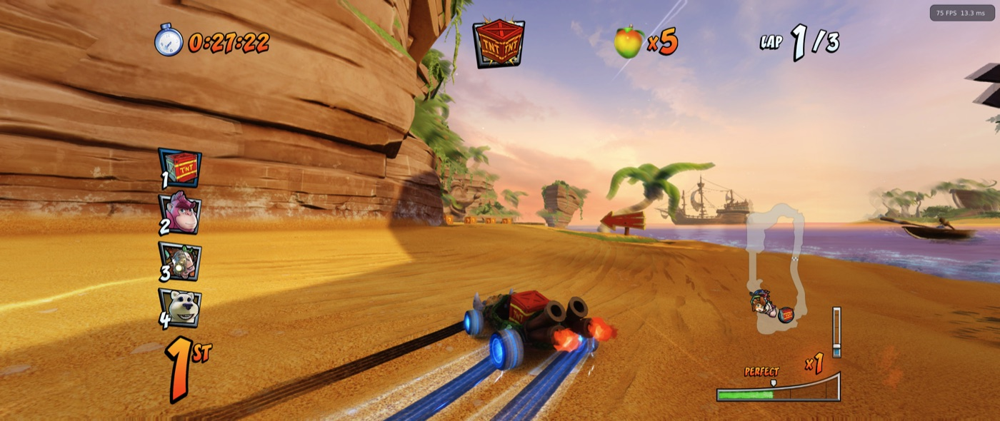 | 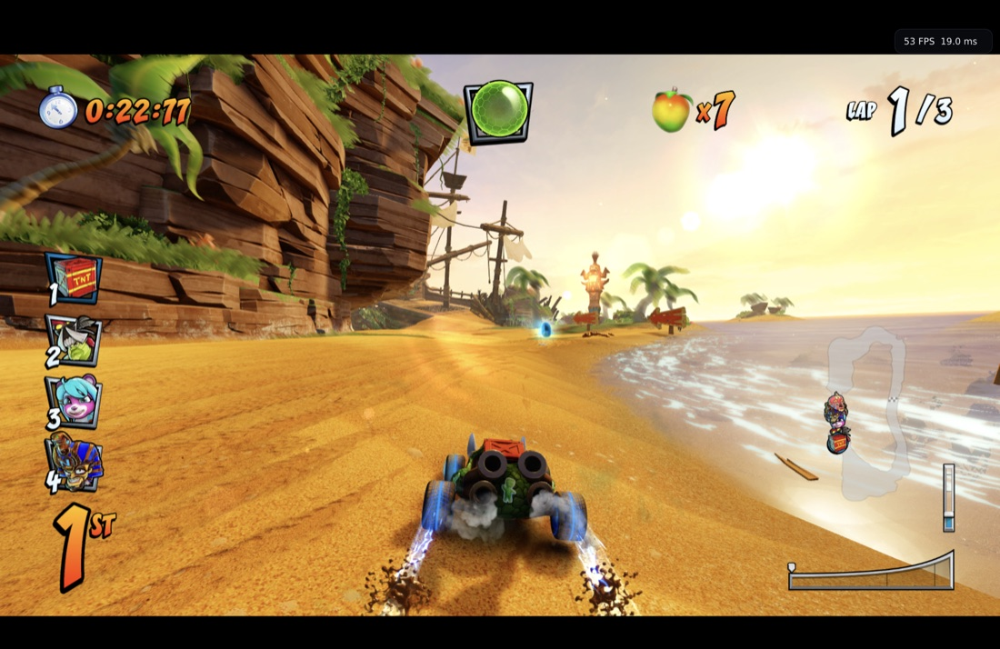 |
| 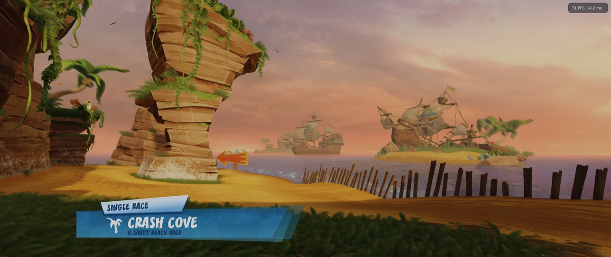 | 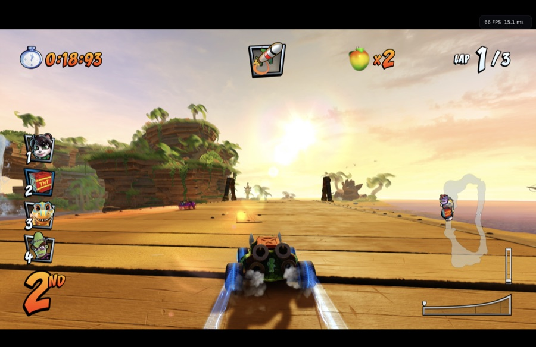 |

| Online: loading a race (FPS + ping) | Online: racing other players |
|---|---|
| 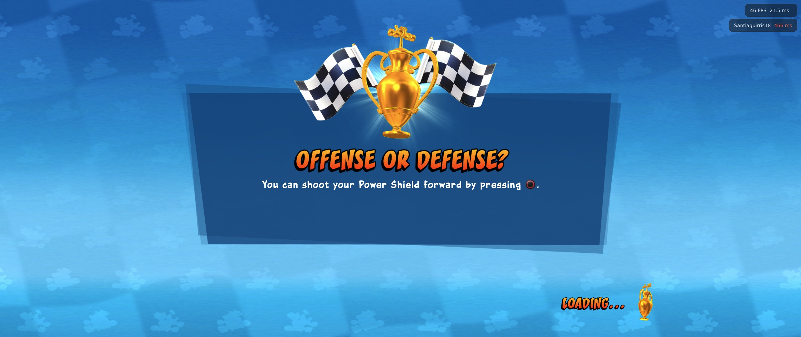 |  |

| Online lobby | Kart select |
|---|---|
| 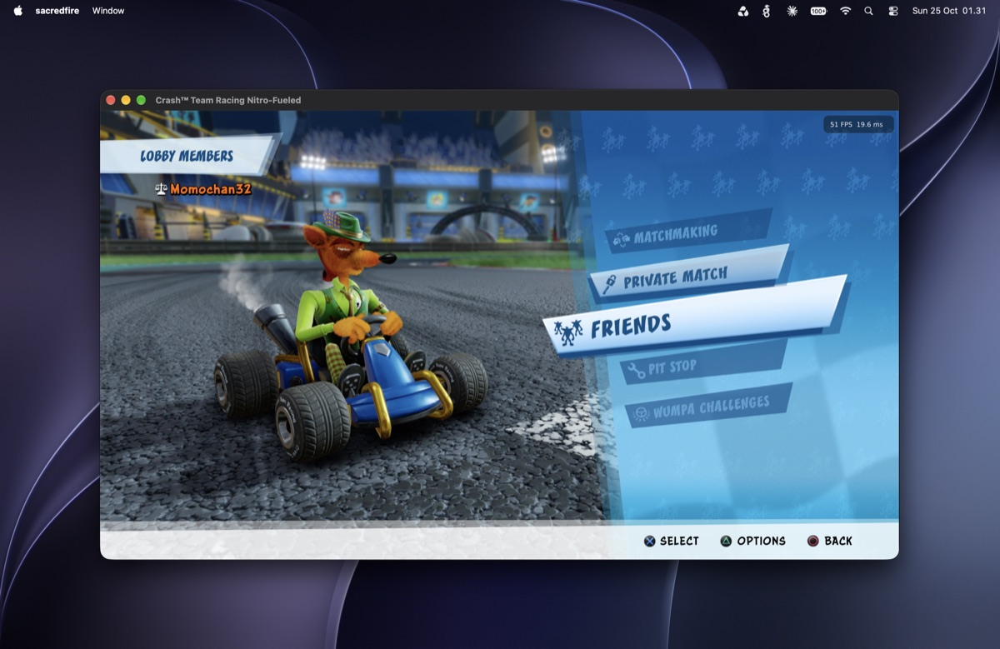 | 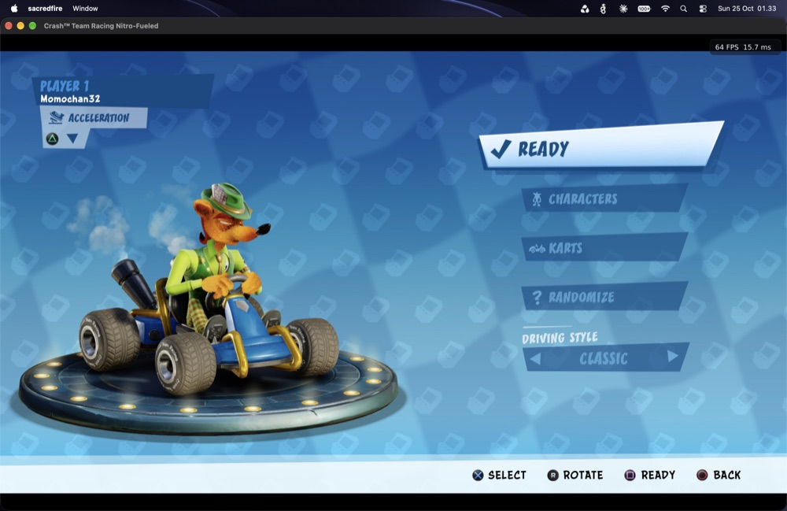 |

| Launcher (Indonesian) | Achievements |
|---|---|
| 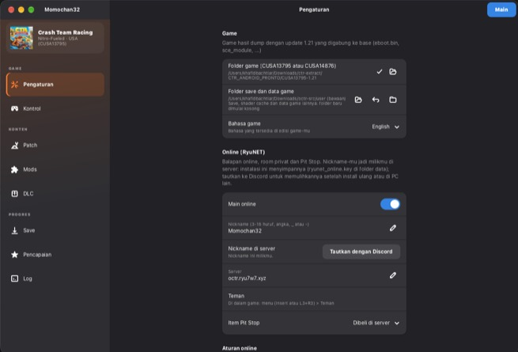 | 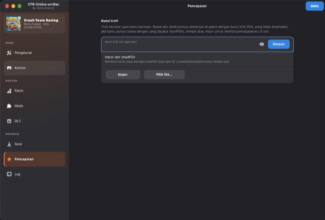 |

### Test results (one device: MacBook Pro M3 Max)

These numbers come from personal testing on a single Mac, not an official benchmark. Other Macs may differ.

| Scenario | FPS while racing |
|---|---|
| Ultrawide 2560×1080 monitor (75 Hz), 21:9 layout | ~75 (monitor limit) |
| Online race on the ultrawide | ~61 |
| MacBook screen, PS4 Pro mode + FSR 3.1 AA | ~63–70 |

---

## Installation

### Requirements
- Apple Silicon Mac, macOS 14 or newer (tested on an M3 Max only)
- **Rosetta 2** (see [About Rosetta 2](#about-rosetta-2)). If it is missing, the app tells you how to install it:
  `softwareupdate --install-rosetta --agree-to-license`
- **Your own game.** A dump of CTR Nitro-Fueled from a console/copy you legally own. The supported version is **CUSA13795 (USA) with the 1.21 update merged**; the European CUSA14876 is experimental. Other versions can be started with **Settings → Allow other game versions (experimental)**, but the patches and online play are made for 1.21 and may not work there. **This repository and its releases do not include, share or link to any game files, firmware or keys.** Requests for game files cannot be answered.

Nothing else is needed: Python, GTK 4 and bash are bundled inside the app (no Homebrew).

### Install
1. Download `CTR-Online-on-Mac.dmg` from [Releases](https://github.com/momochan32/ctr-on-mac/releases).
2. Open the DMG and drag **CTR-Online on Mac** to **Applications**.
3. Open it. The app is signed with a Developer ID and notarized by Apple, so macOS only asks to confirm the first start.

### First start
1. **Settings → Game**: choose the game folder that contains `eboot.bin`.
2. Press **Play**. The first time, the launcher asks you to **choose your own nickname** (3–16 letters, digits, `_` or `-`). Nothing is filled in for you: Play starts the game only once a valid nickname is set. It is your name in the game and online, and the first installation to use a nickname online keeps it. You can change it later in **Settings → Online (RyuNET)**.
3. (Optional) **Online (RyuNET)**: turn it on in Settings to race other players.
4. The first start prepares the shaders (about 2 minutes).

Settings and saves live in `~/Library/Application Support/CTR-Online`. The in-game menu opens with **Shift + W** (or F1 / Insert / L3+R3).

---

## About Rosetta 2

The game's code is PS4 (x86-64) code, and it runs directly on the CPU through Apple's **Rosetta 2**, so the game part of the app is an Intel program. The launcher itself is native Apple Silicon.

- Rosetta 2 is installed once per Mac (the app checks it at start).
- **Apple has announced that macOS 28 removes Rosetta 2.** macOS shows a notice that the app "will not open in macOS 28". On macOS 26 and 27 everything works. **If you want to keep playing, stay on macOS 27 or older** until a solution exists; there is none yet, and it affects every PS4 emulator that runs the game's code this way on a Mac.

## Updates

The launcher checks this repository's releases at start. When a new version is out, a banner offers **Update**: it downloads the DMG, checks it and replaces the app; your settings and saves stay where they are.

## Community

Help, updates and discussion for the Mac version: **[Telegram group t.me/ctronmac](https://t.me/ctronmac)**. Questions about the online server itself (rules, bans) belong in the OCTR community.

## About online play

Online play uses the **OCTR project's RyuNET server**, not a server run by this fork.
- Rules, moderation and bans are entirely up to the OCTR admins. Follow their rules (shown in the launcher).
- Questions or appeals about the server belong in the OCTR community (Discord link in the launcher).
- The Mac version may behave differently from the official builds. Any request from the server admins about unofficial clients will be followed.

---

## Known limitations

- MSAA is not available on the Mac yet; FSR 3.1 anti-aliasing is used instead.
- PS4 Pro mode turns off while a 21:9 layout is on (upstream behavior).
- The MacBook screen (16:10) shows thin black bars, since the game is 16:9.
- Tested on one device only (MacBook Pro M3 Max).

---

## Building from source

```sh
git clone --recursive https://github.com/momochan32/ctr-on-mac && cd ctr-on-mac
# libraries come from a shadPS4 checkout (SHADPS4_EXTERNALS), plus the Vulkan loader + KosmicKrisp
cmake -S gpu -B out/gpu-mac -G Ninja -DCMAKE_OSX_ARCHITECTURES=x86_64 -DBB_LTO=OFF
ninja -C out/gpu-mac sacredfire bb-gpu-capabilities
./packaging/macos/make_dmg.sh        # -> out/CTR-Online on Mac.dmg
```

---

## Credits & thanks

Thank you to everyone whose work this port is built on:

- **T3CHNOLOG1C**: SacredFire, the native Linux port.
- **GetLostIn**: CTR-NitroFueled-PC (the Windows build; MSAA, fur and rendering fixes).
- **Ryu7w7** and the OCTR contributors: RyuNET online play, the server, launchers, mods and many fixes.
- **OCTR contributors** named in its release history, among them tcosi (21:9/32:9 layouts, mods), Brony666 (Linux launcher, Achievements, Mods), SoyAlejandroCalixto, Vo1dTear, n0buholic, MetaHeart and Naif Alqurashi. The full list is in [README-OCTR.md](README-OCTR.md) and this repository's commit history.
- **bbport**: the original runtime design.
- **The shadPS4 team**: the graphics core and shader recompiler.
- **The Mesa / KosmicKrisp developers**: Vulkan on Metal.
- **illusion** (PS-Game-Patch): 60 FPS and motion blur patches. **TroyWarez**: Pro 1080p patch. **Camiloop**: Unlock Everything.
- **AMD**: FidelityFX FSR 3.1.
- **The Crash Team Racing community**.

The macOS port was developed with the help of Claude (Anthropic) as a coding assistant, which is why some commits carry `Co-Authored-By: Claude`.

If anyone is missing or credited incorrectly, please open an Issue and it will be fixed promptly.

---

## License & legal

- The code is licensed under **GPL-2.0-or-later**, like the upstream project (see [LICENSE](LICENSE)). Third-party components keep their own licenses. Complete source for every release is in this repository.
- *Crash Team Racing Nitro-Fueled*, *Crash Bandicoot* and related marks belong to **Activision Publishing, Inc.** *PlayStation* and *PS4* are trademarks of **Sony Interactive Entertainment**. They are used only to describe compatibility.
- A non-commercial community project for personal use and preservation: it is not sold, accepts no donations, and contains no content owned by the game's rights holders.
- Rights holders with concerns about this repository can reach out through Issues, and they will be addressed promptly.

> The upstream OCTR README: [README-OCTR.md](README-OCTR.md)
